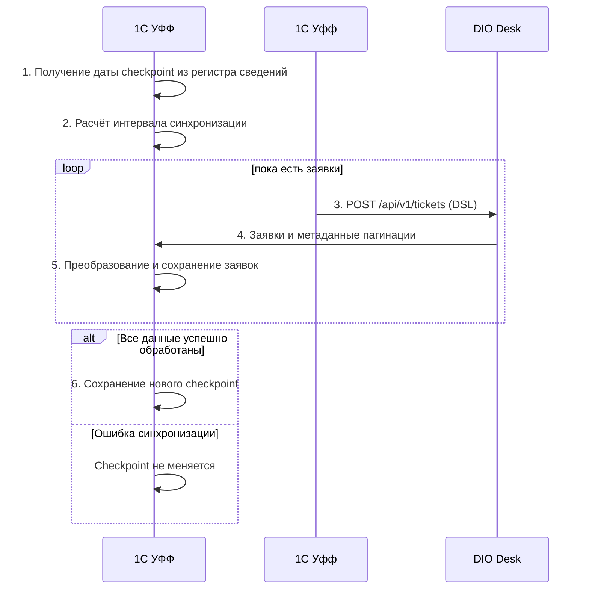

# Интеграция DIO-Desk с 1С УФФ

## Логика периодической синхронизации

Для синхронизации заявок и заданий используется механизм Pull-based Polling.
Инициатором обмена выступает 1С УФФ, которая периодически обращается к API DIO-Desk.



### 1. **Формирование запроса**

УФФ хранит в регистре сведений дату последней **успешно завершённой синхронизации** (`lastSuccessfulSync`).

Перед каждой итерацией временной интервал определяется по следующей формуле:

$$
syncFrom = lastSuccessfulSync - backfill
$$

$$
syncUntil = now - safetyDelay
$$

Где:

 - `syncFrom` - нижняя граница выборки (с какого момента получаем данные)
 - `syncUntil` - верхняя граница (до какого момента получаем данные)
 - `backfill` - окно повторного чтения данных для компенсации задержек и возможных расхождений времени.
 - `safetyDelay` -  задержка верхней границы выборки относительно текущего времени, уменьшающая вероятность чтения ещё не завершённых изменений.
 - `now` - текущее время в формате UTC.
 - `lastSuccessfulSync` - дата последней успешной синхронизации

**Пример запроса**

```plain
POST /api/v1/tickets?pagination=cursor&size=100&sort=updatedAt:asc
Content-Type: application/json
```

```json
{
  "op": "$and",
  "filters": [
    {
      "field": "updatedAt",
      "op": "$gte",
      "value": "2026-10-22T08:55:00Z"
    },
    {
      "field": "updatedAt",
      "op": "$lt",
      "value": "2026-10-22T10:00:00Z"
    }
  ]
}
```

Документация [DSL](https://andr171p.github.io/py-ddd-framework/recipes/dsl-endpoint/?h=dsl) (могут быть неточности, пока активно дорабатывается)

Где:

 - `2026-10-22T08:55:00Z` - нижняя граница
 - `2026-10-22T10:00:00Z` - верхняя граница

**Что нужно учесть**

 - Дата и время передаётся в формате UTC
 - Сортировка выполняется по `updatedAt` (в скором времени будет поддержка UUIDV7, что позволит гарантировать детерминированный порядок по `id`)
 - Данные загружаются постранично, пока не будут обработаны все записи интервала

### 2. Получение данных

DIO-Desk обрабатывает запрос и возвращает заявки удовлетворяющие условиям запроса

При необходимости получения дополнительных данных - обращаться к API DIO-Desk.

**Что нужно учесть**

 - При загрузке дополнительных данных рекомендуется использовать пакетное получение, для избежания N+1 проблемы.

### 3. Обработка данных УФФ

Для каждой полученной заявки выполняются:

 1. Поиск соответствующего объекта в УФФ по внешнему идентификатору DIO-Desk.
 2. Преобразование данных в формат 1С.
 3. Создание объекта, если он отсутствует.
 4. Обновление существующего объекта, если данные изменились.

Операции сохранения должны быть идемпотентными: повторная обработка одной заявки не должна создавать дубликаты или нежелательные побочные эффекты.

### 4. Сохранение состояния 

После успешной обработки всех страниц текущей итерации УФФ сохраняет значение `syncUntil` в регистр сведений в качестве нового `lastSuccessfulSync`.

При возникновении ошибки:

 - дата последней успешной синхронизации не продвигается;
 - ошибка регистрируется в журнале;
 - следующая итерация повторно запрашивает необходимые изменения.

Повторное выполнение безопасно благодаря идемпотентной обработке.

**Что нужно учесть**
 - Checkpoint должен храниться отдельно для каждого независимого потока синхронизации (например, заявки и задания)

### 5. Первичная синхронизация

Если `lastSuccessfulSync` отсутствует, УФФ выполняет первичную загрузку всех необходимых объектов.

После первичной загрузки необходимо применить изменения, возникшие за время её выполнения, и сохранить согласованное состояние синхронизации.

### 6. Ограничения и особенности

**Удалённые объекты**. В DIO Desk реализовано мягкое удаление (soft-delete), данные не удаляются фактически, а устанавливается значение в поле `deletedAt`.

**Гарантии доставки**. `backfill` и `safetyDelay` снижают вероятность пропуска изменений, но не исключают её полностью, например при длительных незавершённых транзакциях.

**Длительная недоступность УФФ**. Система должна продолжать синхронизацию от момента последней успешной синхронизации (checkpoint), а не только за последние N минут.

**Производительность**. Необходимо ограничить размер страницы (в DIO Desk лимит 100 элементов за один раз) и частоту запросов, предусмотреть таймауты и повторные попытки с задержкой.
